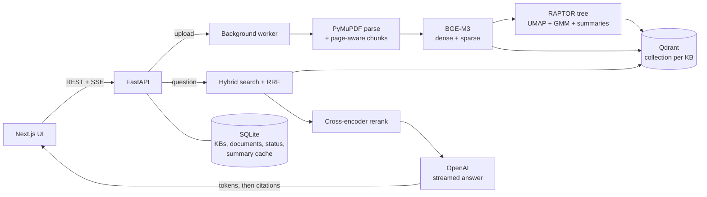

# RAPTOR RAG — Document Q&A with Hierarchical Retrieval

Ask questions about your PDFs and get streamed answers that cite the exact passage and page
they came from. Documents are organized into knowledge bases, indexed in the background, and
searched with hybrid retrieval, a cross-encoder reranker and optional **RAPTOR** summary trees.

**Stack:** Python 3.12 · FastAPI · Qdrant · BGE-M3 · bge-reranker-v2-m3 · OpenAI · UMAP + scikit-learn · Next.js 16 · Tailwind

## Features

- **Knowledge bases** — create, rename and delete; each has its own Qdrant collection.
- **PDF upload with live status** — parsing, embedding and tree building run as a background
  job (`queued → parsing → embedding → building_tree → ready | failed`) with progress.
- **Hybrid retrieval** — BGE-M3 dense and sparse (lexical) vectors fused with reciprocal rank
  fusion, then reranked by a cross-encoder.
- **RAPTOR trees** — each document's chunks are clustered and summarized recursively, so broad
  questions can match section-level summaries while detailed questions match the original text.
- **Grounded, cited answers** — every factual sentence cites a numbered source; if the documents
  don't contain the answer, the model says so instead of guessing. Click a citation to see the
  passage, document and pages.
- **Clean deletes and re-indexing** — removing a document removes all of its chunks and summary
  nodes; re-indexing never duplicates them. Both are covered by tests.
- **Measured, not claimed** — an evaluation harness compares retrieval setups with retrieval
  metrics and LLM-judged answer quality ([results](#evaluation)).

## Architecture



### How a question is answered

1. The question is embedded with BGE-M3 (dense + sparse).
2. Qdrant searches both vector types across chunks **and** RAPTOR summaries of ready documents
   and fuses the rankings (RRF) into 30 candidates.
3. `bge-reranker-v2-m3` reads the question with each candidate and keeps the best 6.
4. The model answers from those numbered sources only, citing them as `[n]`.
5. The API streams the answer as server-sent events, then sends only the sources the answer
   actually cited.

### How RAPTOR works here

Following [Sarthi et al., 2024](https://arxiv.org/abs/2401.18059): chunk embeddings are reduced
with UMAP, grouped by a Gaussian mixture model (cluster count chosen by BIC, soft assignment so a
chunk can join several clusters), and each cluster is summarized by `gpt-6-luna`. The summaries
are embedded and clustered again, up to three levels. All nodes go into the same collection
("collapsed tree" retrieval), each carrying its page range and child ids.

## Quick start

Requirements: Python 3.12 with [uv](https://docs.astral.sh/uv/), Node 24, Docker, an OpenAI API key.

```bash
# 1. Vector database
docker run -d --name raptor-qdrant -p 6333:6333 -v raptor_qdrant:/qdrant/storage qdrant/qdrant:v1.19.1

# 2. Backend (first start downloads the BGE models, ~6.5 GB)
cd backend
cp .env.example .env        # then add your OPENAI_API_KEY
uv sync --extra ml
uv run uvicorn raptor_rag.api:create_app --factory --port 8000

# 3. Frontend (in another terminal)
cd frontend
npm ci
npm run dev                 # http://localhost:3000
```

API docs are served at <http://localhost:8000/docs>.

### Deploying

The frontend and backend find each other through two settings. For a frontend at
`https://app.example.com` and an API at `https://api.example.com`:

```bash
# frontend (at build time)
NEXT_PUBLIC_API_URL=https://api.example.com
# backend .env — the browser origins allowed to call the API (JSON list)
CORS_ORIGINS='["https://app.example.com"]'
```

Other backend settings (models, chunk size, retrieval depth, upload limit) are in
[`backend/src/raptor_rag/config.py`](backend/src/raptor_rag/config.py) and can be set the same way.

## API

| Method | Path | Purpose |
|---|---|---|
| `POST` | `/kb` | Create a knowledge base (`name`, `raptor_enabled`) |
| `GET` | `/kb` | List knowledge bases |
| `PATCH` | `/kb/{id}` | Rename |
| `DELETE` | `/kb/{id}` | Delete with all documents and vectors |
| `POST` | `/kb/{id}/documents` | Upload a PDF (multipart) → 202, indexed in the background |
| `GET` | `/kb/{id}/status` | Knowledge base and its documents with status and progress |
| `DELETE` | `/kb/{id}/documents/{doc_id}` | Delete a document, its chunks and its tree |
| `POST` | `/kb/{id}/documents/{doc_id}/reindex` | Re-index a document |
| `POST` | `/kb/{id}/query` | Ask a question → SSE: `token`…, `citations`, `done` |

## Evaluation

`backend/evals/run.py` compares four setups on ~50 questions drafted from the indexed documents
(specific fact questions and broad, multi-section questions):

| Setup | What it adds |
|---|---|
| Dense only (baseline) | plain vector search |
| Hybrid | + sparse vectors and rank fusion |
| Hybrid + rerank | + cross-encoder reranking |
| Hybrid + rerank + RAPTOR | + summary nodes from the RAPTOR trees |

Metrics: **recall@5** and **MRR** (did retrieval find a passage from the question's source
pages?), and LLM-judged **context recall**, **faithfulness** (claims supported by the sources),
**citation accuracy** and **answer relevance**, graded by `gpt-6.1-sol` with structured outputs.

Results: see [`backend/evals/results.md`](backend/evals/results.md).

```bash
cd backend
uv run python -m evals.run setup data/samples
uv run python -m evals.run questions --specific 30 --broad 20
uv run python -m evals.run score --batch
```

## Design decisions

- **One RAPTOR tree per document, not per knowledge base.** Summaries never mix documents, so
  deleting a document is a single filter delete and uploading one doesn't rebuild everyone
  else's tree. The trade-off is no cross-document summaries.
- **One Qdrant collection per knowledge base.** Deleting a knowledge base drops one collection;
  there is no way for a query to leak across knowledge bases.
- **Only fully indexed documents are searched**, so a document that is still embedding or being
  re-indexed never produces half-complete answers.
- **In-process background worker + SQLite.** Simple to run and enough for a single server; jobs
  interrupted by a restart are marked failed and can be re-indexed. A multi-instance deployment
  would swap in a persistent queue.
- **Cheap model for summaries, strong model for answers.** RAPTOR makes many summary calls, so
  they use `gpt-6-luna` and are cached by content hash; answers and grading use `gpt-6.1-sol`.

## Project structure

```
backend/
  src/raptor_rag/   api, ingestion worker, chunking, embeddings, Qdrant store,
                    RAPTOR, reranker, LLM client, RAG pipeline
  tests/            pytest suite (in-memory Qdrant and fake models)
  evals/            evaluation harness
frontend/           Next.js app (knowledge bases, documents, chat)
legacy/             the original 2024 notebook this project grew from
```

## Credits

- RAPTOR: Sarthi et al., *RAPTOR: Recursive Abstractive Processing for Tree-Organized Retrieval*,
  ICLR 2024 — [paper](https://arxiv.org/abs/2401.18059), [code](https://github.com/parthsarthi03/raptor).
- The original notebook in `legacy/` adapted its clustering code from the
  [LangChain RAPTOR cookbook](https://github.com/langchain-ai/langchain/blob/master/cookbook/RAPTOR.ipynb).
- Models: [BGE-M3](https://huggingface.co/BAAI/bge-m3) and
  [bge-reranker-v2-m3](https://huggingface.co/BAAI/bge-reranker-v2-m3) by BAAI.
